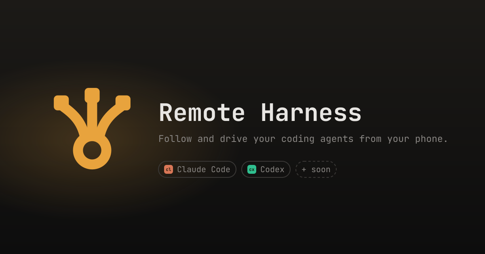
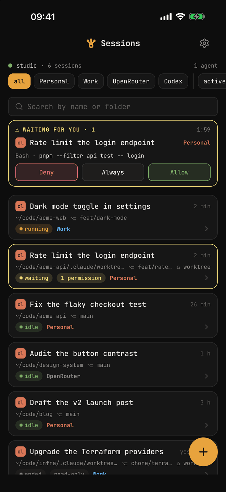
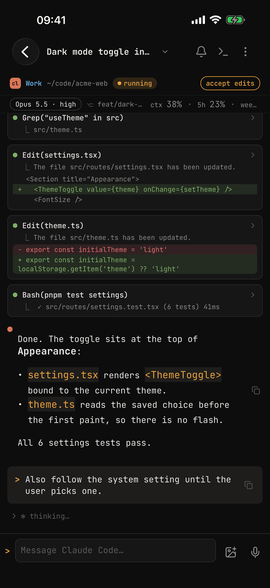
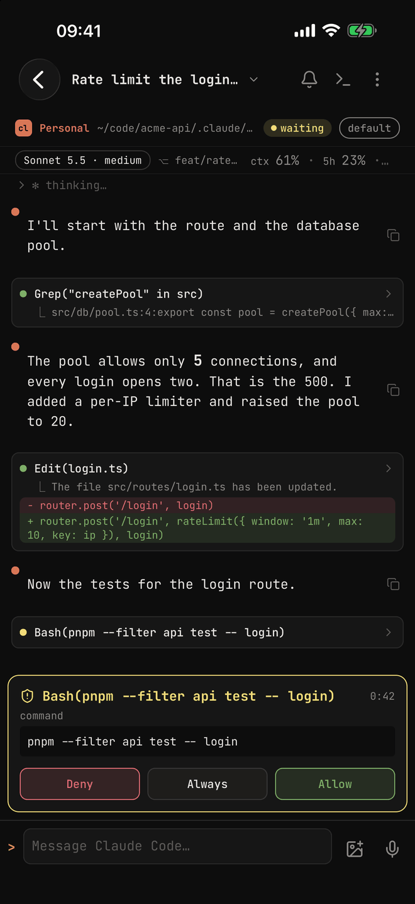
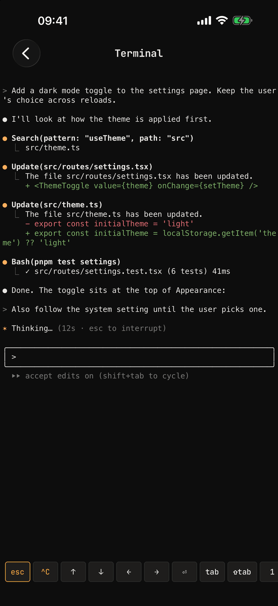
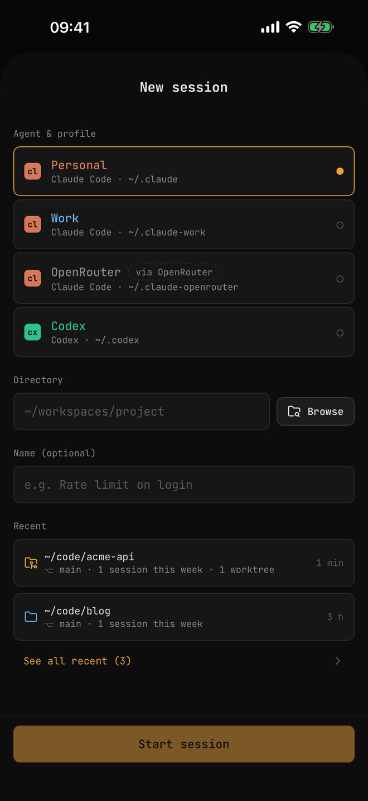
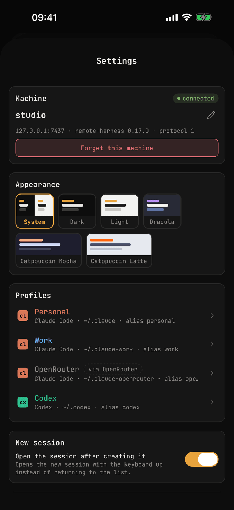
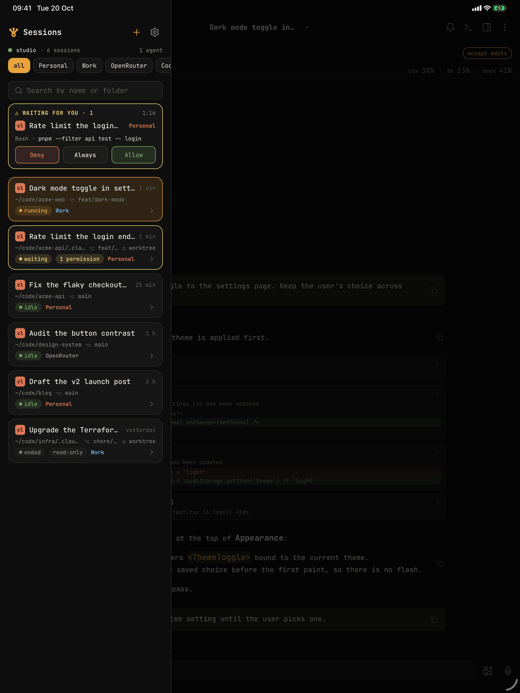

<div align="center">



# Remote Harness

**Follow and drive your coding agents — Claude Code and Codex CLI — running on your Mac, Linux or Windows (WSL) machine, from your iPhone or Android phone.**

Self-hosted: a small daemon on your computer, a native app on your phone, a private Tailscale link in between.<br/>No cloud relay, no account-wide notifications, every profile in one list.

[](https://github.com/maarkN/remote-harness/releases)
[](LICENSE)


[](CONTRIBUTING.md)

[Documentation](https://remoteharness.app/docs/) · [Português](README.pt-BR.md) · [Contributing](CONTRIBUTING.md) · [Security](SECURITY.md)

</div>

<p align="center">
  
  
  
  
</p>
<p align="center">
  
  
  
</p>

---

## Why

Claude Code is at its best on long, autonomous tasks — which is exactly when you walk away from the desk. Then it stops to ask for permission to run `pnpm test`, and the whole task waits until you are back.

The built-in remote control (`/rc`) helps, but it did not fit a real setup:

- **It notifies every device on the account**, including ones that should never receive anything.
- **It works with one account at a time.** Many of us run two Claude Code logins on the same computer (personal and work, via `CLAUDE_CONFIG_DIR`) and want a single view of both.
- **There is no public API to attach to a live interactive session** from another process.

Remote Harness solves this with tools you already trust: sessions run inside **tmux**, Claude Code reports what happens through its native **HTTP hooks**, and a local **daemon** bridges both to the phone over **Tailscale**.

## Status

**Alpha.** Releases are on [GitHub Releases](https://github.com/maarkN/remote-harness/releases), each tagged `-ALPHA` while the project is being tested. It is used every day by its authors, but expect rough edges and breaking changes between versions.

- **Computer:** macOS, Linux and Windows (WSL2), installed with one command and updated with `remote-harness update` (or automatically, from the menu bar).
- **Phone:** iOS/iPadOS and Android 10+. Not in the stores yet: install the Android APK from the releases or build the app yourself ([getting started](https://remoteharness.app/docs/getting-started/#install-the-app)); TestFlight and Google Play are in progress ([#161](https://github.com/maarkN/remote-harness/issues/161)). Installed builds get JavaScript updates over the air.
- **Agents:** Claude Code (any number of accounts, also through OpenRouter) and Codex CLI. Kimi and Qwen Code are planned.
- **Languages:** the app, the CLI, notifications and the [site](https://remoteharness.app) in English, Brazilian Portuguese and Spanish.

## What it does

| | |
|---|---|
| 📋 **One list, every profile** | Sessions from all your profiles (`~/.claude`, `~/.claude-work`, `~/.codex`, …), sorted by what moved last, with live state (running, waiting, idle) and a "waiting for you" strip on top. |
| 🤖 **Claude Code and Codex** | Claude Code profiles — on your Anthropic accounts or [OpenRouter](https://openrouter.ai) models — and Codex CLI profiles side by side, each with its own launcher. |
| 💬 **Live conversation** | The same history you see on the computer: markdown, thinking, tool calls, diffs, results — streamed in real time and paginated. |
| ⌨️ **Send prompts** | Type into the very same process that is open on the computer, `Esc` and `Ctrl+C` included. Queue follow-ups while the agent works (or send now), keep a draft per session, dictate on-device and attach photos. |
| ✅ **Approve permissions** | Allow, deny or **always allow** (written as a rule by Claude Code itself, undoable with `remote-harness rules undo`). Answer the agent's questions and approve its plans. |
| 🔀 **Switch permission mode** | Default, accept edits, plan, auto. `bypassPermissions` is intentionally never offered. |
| 🔎 **Autocomplete** | `@files` (git/ripgrep + fuzzy search) and every `/command` (built-ins, project, profile and plugins), with your recent ones first. |
| 🖥️ **Raw terminal** | An xterm.js view of the tmux pane for TUI menus and anything the structured view does not cover. |
| 🧩 **Subagents** | Follow subagents and background tasks of a session. |
| 🚀 **Start, resume, close** | Start a new session in any folder (with a folder picker and recents), resume a read-only one, and close it with a worktree clean-up that never discards work silently. |
| 🌿 **Shared checkout warning** | Each session shows its git branch; sessions working in the same checkout are flagged, and a new one can start in its own git worktree. |
| 🔔 **Private push** | Notifications only to *your* registered phone, carrying no session content. Mute globally, per profile or per session. |
| ⏱️ **Live status** | While a session works, its state, step type, running tasks and elapsed time show on the lock screen and in the Dynamic Island (iOS Live Activity) or in a silent notification (Android). |
| 📱 **Phone and iPad** | Five themes (dark, light, Dracula, Mocha, Latte), an iPad layout with a session sidebar and inspector, and hardware keyboard shortcuts. |
| 🔄 **Menu bar and updates** | A menu bar / tray icon on the computer with the daemon's status and updates; the phone can update the computer too. |
| 🧯 **Error reports** | Opt-in crash and error reports, scrubbed of anything from your sessions, and a "Report a problem" screen. |

## How it works

```
┌──────────────┐  WebSocket over Tailscale   ┌─────────────────────────────────┐
│  phone app   │ ◄─────────────────────────► │ remote-harness daemon (computer)│
│ iOS / Android│       token-authenticated   │  ├─ tmux: send-keys / capture   │
└──────▲───────┘                             │  ├─ tails transcript .jsonl     │
       │ push (FCM, no content)              │  └─ HTTP hooks on 127.0.0.1     │
       └─────────────────────────────────────┤                                 │
                                             └───────────────┬─────────────────┘
                                                             │ hooks
                                          ┌──────────────────┴──────────────────┐
                                          │ tmux session "claude-remote"        │
                                          │  ├─ pessoal  → ~/.claude            │
                                          │  └─ trabalho → CLAUDE_CONFIG_DIR=…  │
                                          └─────────────────────────────────────┘
```

1. You start Claude Code with a tiny launcher (one per account, named by you, e.g. `pessoal`, `trabalho`) that runs it inside a tmux window.
2. Claude Code's HTTP hooks tell the daemon when a session starts, stops, needs permission or gets a prompt. A small status line wrapper also forwards the model, effort, context usage and usage limits — and then runs your own status line, so the terminal looks the same.
3. The daemon tails the session transcript, reads the tmux pane, and serves everything to the app over an authenticated WebSocket bound **only** to the Tailscale interface.
4. Prompts and keys go back through tmux; permission answers go back through the pending hook request.

Sessions started with plain `claude` (outside tmux) still show up — read-only — and can be resumed from the phone.

**Codex CLI** works the same way through its own command hooks (`<CODEX_HOME>/hooks.json`) and session rollouts: start, resume, prompts, Allow/Deny on permission requests and the conversation, without worktrees or "always allow" rules.

## Security model

The daemon is effectively a remote shell, so it is locked down by default: the WebSocket listens **only on the Tailscale interface** (or `127.0.0.1` with an explicit `--dev`) and every connection presents a token kept in the OS secret store; the hooks endpoint listens only on `127.0.0.1` with a local secret; push carries no session content; `bypassPermissions` is never offered; and every edit to your files is merged, backed up, written atomically and reverted by `remote-harness uninstall`. The details are in [Security & privacy](https://remoteharness.app/docs/security/); report a vulnerability through [SECURITY.md](SECURITY.md).

## Getting started

On the computer (macOS, Linux or WSL2), one line installs the daemon and opens a guided setup that finds your Claude Code accounts, asks the alias of each one, installs the hooks and the background service, and shows the pairing QR code:

```bash
curl -fsSL https://remoteharness.app/install | bash     # macOS and Linux
irm https://remoteharness.app/install | iex             # Windows PowerShell (installs WSL2 if needed)
```

Then install the app and Tailscale on the phone, scan the code, and run your alias instead of `claude`. Everything else is in the [documentation](https://remoteharness.app/docs/), in English, Portuguese and Spanish:

| Topic | Where |
|---|---|
| Requirements, install on macOS, Linux and Windows (WSL2), install from a clone | [Getting started](https://remoteharness.app/docs/getting-started/) |
| Installing the app, pairing, the first session, updating | [Getting started](https://remoteharness.app/docs/getting-started/#install-the-app) |
| Session list, prompts, permissions, terminal, worktrees, live status, settings, iPad | [Using the app](https://remoteharness.app/docs/using-the-app/) |
| Notifications and mute | [Using the app](https://remoteharness.app/docs/using-the-app/#notifications-and-mute) |
| CLI commands, the config file (`~/.remote-harness/config.json`), OpenRouter and Codex profiles | [The daemon](https://remoteharness.app/docs/daemon/) |
| Background service, updates and channels, menu bar / tray icon, logs | [The daemon](https://remoteharness.app/docs/daemon/#background-service) |
| What leaves your machine, tokens, your files, error reports | [Security & privacy](https://remoteharness.app/docs/security/) · [Privacy policy](https://remoteharness.app/docs/privacy/) |
| Linux service and lingering, WSL2 (systemd, logon task, Tailscale), sleep, push, read-only sessions | [Troubleshooting](https://remoteharness.app/docs/troubleshooting/) |
| Uninstall: `remote-harness service uninstall`, then `remote-harness uninstall` | [The daemon](https://remoteharness.app/docs/daemon/#commands) |

## Tech stack

| Area | Tools |
|---|---|
| Monorepo | pnpm workspaces, Turborepo, TypeScript (strict), Biome, Vitest |
| Protocol | Zod schemas shared by daemon and app — single source of truth |
| Daemon | Node 24, `ws`, Fastify, Pino, Commander, execa, chokidar, fuzzysort, firebase-admin, tsup |
| App | Expo SDK 57, React Native, Expo Router, Zustand, TanStack Query, FlashList, react-native-marked, xterm.js (WebView), expo-secure-store, expo-camera, React Native Firebase |
| Site and services | Node and Vite (remoteharness.app in Docker behind Traefik), Firebase Cloud Functions (push relay), a Cloudflare Worker (relay address) |
| Planning | [OpenSpec](https://github.com/Fission-AI/OpenSpec) — every feature started as a numbered change with specs and tasks |

## Project structure

```
apps/daemon        Node daemon: WebSocket for the app, HTTP for hooks, tmux, transcripts, push
apps/mobile        Expo app (Expo Router, feature folders, terminal-style dark theme)
apps/web           remoteharness.app: landing, docs, installers, updates server, install links (Node in Docker)
apps/push-relay    Cloud Function that sends push for daemons without a service account
apps/push-edge     Cloudflare Worker on push.remoteharness.app in front of the push relay
packages/protocol  Zod schemas + types of the WebSocket protocol
openspec/          Specs and every archived change that built the project
.docs/             The original product requirements document (Portuguese, from when it was called Claude Remote)
```

Architecture and conventions are documented in [CLAUDE.md](CLAUDE.md).

## Development

```bash
pnpm install
pnpm check                                             # typecheck + tests + Biome across the monorepo
pnpm --filter @remote-harness/daemon dev start --dev    # daemon from source on 127.0.0.1
pnpm --filter @remote-harness/mobile ios               # app on the iOS simulator (android: emulator)
```

`make` lists the shortcuts. Building and signing the app, the Makefile targets and install links, Firebase for your own builds, the push relay, over-the-air updates and the website deploy are in [CONTRIBUTING.md → Building and releasing](CONTRIBUTING.md#building-and-releasing).

## Limitations

- The daemon runs on macOS, Linux and Windows through WSL2; the app runs on iOS and Android 10+ (built locally or with EAS, not published to the stores yet). On Android the Allow/Deny buttons are not shown on the notification: tap it to answer in the app.
- Sessions must run inside tmux to be controllable; others are read-only until resumed.
- The computer must be awake. The service keeps it from idle-sleeping while sessions run (`remote-harness keep-awake`), but the app cannot wake a computer that already sleeps: Wake-on-LAN does not cross Tailscale, so it needs another always-on device on the same network ([design notes](docs/design/remote-wake.md)).
- Permission-mode switching reads the Claude Code status line, so a TUI change may need a label update (they live in one tested table).
- Codex sessions cannot start in their own worktree, and permission requests offer Allow and Deny only.
- Translations beyond English, Brazilian Portuguese and Spanish are welcome.

## Contributing

Issues and pull requests are welcome! Read [CONTRIBUTING.md](CONTRIBUTING.md) for the workflow (OpenSpec, Conventional Commits, `pnpm check`).

## License

[MIT](LICENSE) © Marco Filho

<sub>Remote Harness is an independent project and is not affiliated with, endorsed by or sponsored by Anthropic or OpenAI. "Claude" and "Claude Code" are trademarks of Anthropic, PBC; "Codex" is a trademark of OpenAI.</sub>
